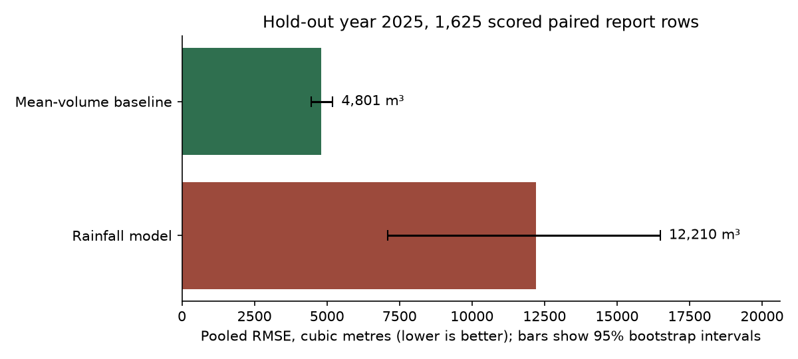

# cso-insight

Can a rainfall model predict the reported volume of combined sewer overflows (CSOs) better than a simple average? On the Massachusetts reports of 2025, no. On the 1,625 paired report rows it could score, a mean-volume baseline per outfall had a pooled RMSE of 4,801 cubic metres (95% interval 4,454 to 5,198), against 12,210 cubic metres (7,101 to 16,489) for the rainfall model. The ranking of outfalls by report count in 2022 to 2024 held in 2025 (Spearman 0.851, 95% interval 0.830 to 0.854, 171 identifiers). Better reporting and local validation are prerequisites before a model like this sets outfall priorities. Values and intervals: [results/evaluation.json](results/evaluation.json).



CSO Insight is an open work sample by ElementeX Labs Inc. It reads public sewer overflow reports from Massachusetts, flags data quality problems, ranks the overflow outlets (outfalls) with intervals and runs the comparison above. The engineer summary and the documentation are published at [elementexlabs.github.io/cso-insight](https://elementexlabs.github.io/cso-insight/).

## Method

1. Download the public Massachusetts overflow file from AMEND (16,720 report rows; snapshot hash pinned).
2. Parse timestamps, convert units and flag data quality issues.
3. Apply the eligibility rules and the volume cap, and record every exclusion in a cohort ledger; the cap changes the reported priorities.
4. Fit a rainfall response model for each outfall with enough training data (at least five variable-rainfall pairs).
5. Rank outfalls by report counts and volumes, with bootstrap intervals.
6. Compare the rainfall model with a simple mean-volume baseline on the same scored subset of 2025 reports (1,625 of 3,075 eligible reports).
7. Write the results file, the JSON summaries and the engineer summary page (`results/report.html`).

Report rows are the counting unit, not reconciled discharges. Code: `src/cso_insight/` behind the `cso-insight` command; tests in `tests/`; outputs in `results/`.

## Results (Massachusetts EEA, hold-out 2025)

Task: Rank outfalls and compare rainfall-response modelling against simple baselines on open notification CSVs.

Data: 16,720 CSO rows from the [Archive of Massachusetts Environmental Data (AMEND)](https://openamend.org/data/EEADP_CSO.csv) feed (snapshot hash pinned in `docs/DATA_MANIFEST.md`). Volume and rainfall are co-reported utility fields; 48% of rows lack one or both measurements.

Headline result: Report-row counts across identifiers are stable from train+validation to 2025. The mean-volume baseline beats the log1p rainfall model on the model-scorable paired test subset. See [generated results](RESULTS.md) for values, intervals and cohort denominators. This Massachusetts demonstration is a work sample; it does not establish local utility validation or operational readiness.

Counting unit: Both Public Notification Report and Verified Data Report rows are retained. A physical discharge can have multiple reports. We have not reconciled stages into distinct discharges. Report-class sensitivity and missingness are exported; the missing-measurement rows are overwhelmingly notification-stage submissions.

Exclusions: The volume cap excludes 156 evaluation-period reports; 159 across the full feed. The 32.1% volume reduction uses 2022-2025 reported volume after other eligibility rules, relative to the same cohort with the volume cap relaxed. This is filter sensitivity, not a verified error correction. The 171 evaluation identifiers include 169 named IDs and two pooled UNKNOWN permittee buckets.

Scoring support: RMSE scores 1,625/1,643 eligible paired 2025 rows and 1,625/3,075 eligible 2025 reports. Eighteen paired rows across ten IDs lack a training model (at least five variable-rainfall pairs required). The baseline uses exactly the same scored subset.

Threshold support: Positive means at or above the training+validation 75th percentile. Of 1,643 eligible test rows with known rainfall, 1,635 have at least three training rainfall observations; eight rows across five identifiers default negative and remain in the denominator. This conditional fraction does not measure detection or accuracy on non-event days.

Evaluation status: The frozen analysis plan is amended retrospectively; pre-result registration is unverified. Its archived bytes and SHA-256 are preserved. Results were seen before `docs/PREREGISTRATION_AMENDMENT_2026-10-01.md` clarified estimands. Rainfall-normalized outfall ranking was not evaluated; Spearman compares raw event counts.

## Checks

Verification covers timestamp parsing, snapshot preservation, measurement units,
cohort denominators, threshold support and reproducible analytical outputs.
See [tests/test_publication_fixes.py](tests/test_publication_fixes.py) and
[tests/test_coverage_gaps.py](tests/test_coverage_gaps.py) for timestamp parsing,
[tests/test_publication_r5.py](tests/test_publication_r5.py) for snapshot preservation,
units and the threshold policy, [tests/test_ingest.py](tests/test_ingest.py) for unit
conversion, and [tests/test_publication_r4.py](tests/test_publication_r4.py) for cohort
denominators, model support and metric reproduction. The analytical results are in
[generated results](RESULTS.md), the [cohort summary](results/cohort_summary.json) and
the [evaluation metrics](results/evaluation.json).
These checks do not establish independent approval, remote CI validation or
operational readiness.

## Rebuild

```bash
python3.11 -m venv .venv
source .venv/bin/activate
pip install -r requirements-lock.txt
pip install --no-deps -e .
./scripts/download_data.sh   # optional: separate, hash-verified acquisition file
cso-insight run --root .
```

Open `results/report.html` for the engineer summary. See `RESULTS.md` for code-generated metrics.

## Related work

Bounded engineering contribution: an integrated open Python work sample that ingests Massachusetts notification CSVs, flags data quality issues, fits per-outfall log1p rainfall-response models, produces descriptive rankings with bootstrap intervals on counts/volumes, and evaluates amended hold-out baselines in one command.

This package offers a packaged strict-typed API, an explicit cohort ledger, an amended held-out comparison and declared stop checks. It makes no claim of a new rainfall-CSO method. AMEND already has tests and automated chart regeneration. Its [analysis/EEA_DP_CSO_map.py](https://github.com/nesanders/MAenvironmentaldata/blob/b0a5c729abb41ba77b24ec0f6df835eee0a5887f/analysis/EEA_DP_CSO_map.py), [tests](https://github.com/nesanders/MAenvironmentaldata/tree/b0a5c729abb41ba77b24ec0f6df835eee0a5887f/tests), and [workflows](https://github.com/nesanders/MAenvironmentaldata/tree/b0a5c729abb41ba77b24ec0f6df835eee0a5887f/.github/workflows) were reviewed on 2026-10-01 (immutable commit `b0a5c729abb41ba77b24ec0f6df835eee0a5887f`; links pinned here). Comparisons are bounded to those paths; no absence-of-capability claims are made.

Pairing utility co-reported fields here involves no external meteorological join. AMEND also performs external weather alignment. SWMM and PySWMM provide hydraulic simulation and a simulation interface, respectively.

Nearest prior art:

- [EPA SWMM](https://www.epa.gov/water-research/storm-water-management-model-swmm) and [PySWMM](https://joss.theoj.org/papers/10.21105/joss.02292): physics-based simulation, not notification analytics.
- [AMEND dashboard and open scripts](https://openamend.org/dashboard.html): CSV-backed discharge analysis, rainfall alignment and reporting-quality views on the same Massachusetts feed; this package adds typed API, cohort exports and amended hold-out metrics.
- McGrath et al. (2019), rainfall controls on CSO variability, [doi:10.1029/2019WR025336](https://doi.org/10.1029/2019WR025336): analytical rainfall-CSO modelling on network and rainfall structure, not notification ingestion.

## Data licence

Primary dataset: Massachusetts EEA CSO notifications via [openamend.org/data/EEADP_CSO.csv](https://openamend.org/data/EEADP_CSO.csv). See [docs/DATA_MANIFEST.md](docs/DATA_MANIFEST.md) for provenance, attribution and redistribution scope. The current outputs contain factual aggregates only. Raw rows, event IDs, individual QA measurements and event-pair scatter are withheld. Historical commits contained record-linked QA derivatives; the separate clean public snapshot excludes that history. Original documentation and figure design licences do not relicense upstream data.

Metro Vancouver publishes a [real-time overflow map](https://metrovancouver.org/services/liquid-waste/real-time-sewer-overflow-map) and annual PDF reports but no open event-level download via the route we reviewed. This work sample uses Massachusetts data to demonstrate methods applicable to regional CSO programs.

## Limitations

- Notification data are utility-reported, not independently audited.
- Volume and rainfall are missing on many rows; descriptive rankings reflect reporting coverage.
- 2022 data begin July 2 (partial year).
- Volume plausibility cap removes large reported overflows from descriptive totals; see sensitivity in `results/cohort_summary.json`.
- Bootstrap intervals resample events, not storms; they omit fitting uncertainty and measurement error.
- The rainfall model does not beat the mean-volume baseline on held-out RMSE.
- Rainfall-normalized outfall ranking was not evaluated.
- Results are for method demonstration, not operational utility decisions.

## Documentation

- [Technical report](docs/technical-report.md) (CC BY 4.0)
- [Data manifest](docs/DATA_MANIFEST.md)
- [Frozen analysis plan, amended retrospectively](docs/PREREGISTRATION_STATUS.md) and [amendment](docs/PREREGISTRATION_AMENDMENT_2026-10-01.md)
- [Plan status](docs/PREREGISTRATION_STATUS.md) and [release procedure](docs/RELEASE.md)

## Licence

Supported reproducible installation: Python 3.11 and 3.12 with the pinned lock. Other versions are not covered by this installation contract. Peak memory has not been measured. Remote CI validation is not established by the checks described here.

Code: Apache-2.0 (see [LICENSE](LICENSE)). Original documentation and figure design in `results/figures/`: [CC BY 4.0](docs/LICENSE-CC-BY-4.0.txt) with source attribution in report captions.

## Record-linking and comparison tools

The offline tools link compatible notification and verified report rows into candidate
records, compare coarse and one-to-one rules, apply two sensitivity vetoes, and check
tolerance changes. These software decisions do not establish physical discharge
identity, measured accuracy, review savings or water benefit.

Run the original synthetic example without installation or network access:

```bash
PYTHONPATH=src python3 -m cso_insight.release_cli --compare
PYTHONPATH=src python3 -m cso_insight.release_cli --tolerance 30 --compare
```

After installation, `cso-insight-linkage` provides the same interface. The example uses
six invented rows and prints aggregates only. The two-veto comparator stays at 15
minutes when the linker's tolerance changes. `--input /path/to/local.csv` accepts
independently rights-held local data; detailed exports require separate review.
`cso-insight score-linkage` scores a local review sheet against its pinned manifest.

This addition includes code and synthetic tests. It withholds the linkage study's
source rows, report and incident identifiers, permittee and outfall values, actual
source clocks, individual measurements, detailed review HTML, ledgers and reviewer
sheets because those assets require separate rights and publication approval.
The existing public baseline documentation and aggregate results remain available.
Synthetic tests cannot reproduce the 18,759-row linkage study without its exact,
separately rights-held snapshot. Code is Apache-2.0; original documentation uses
[CC BY 4.0](docs/LICENSE-CC-BY-4.0.txt). No upstream records are relicensed.

Its code and documentation were written with AI coding assistants under the direction of Amir Daneshpajouh, and checked by their tests and an AI-assisted release check before publication.
