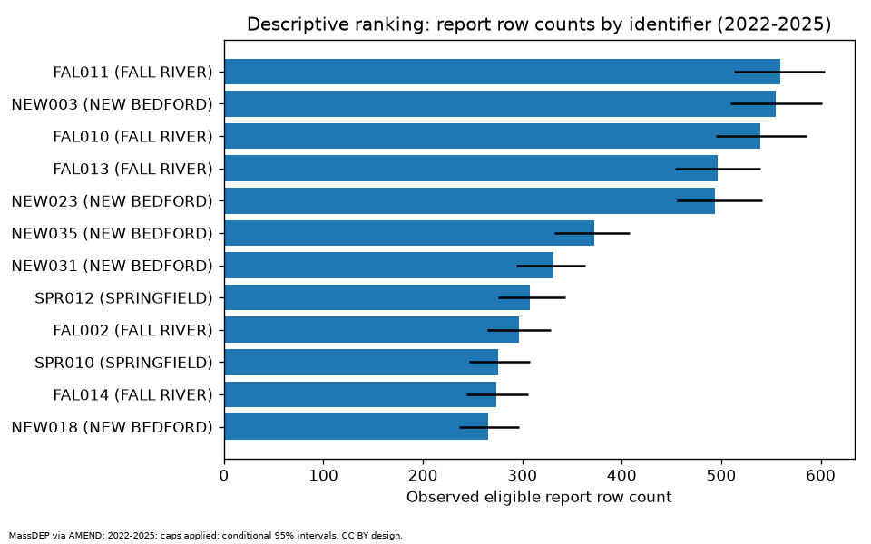
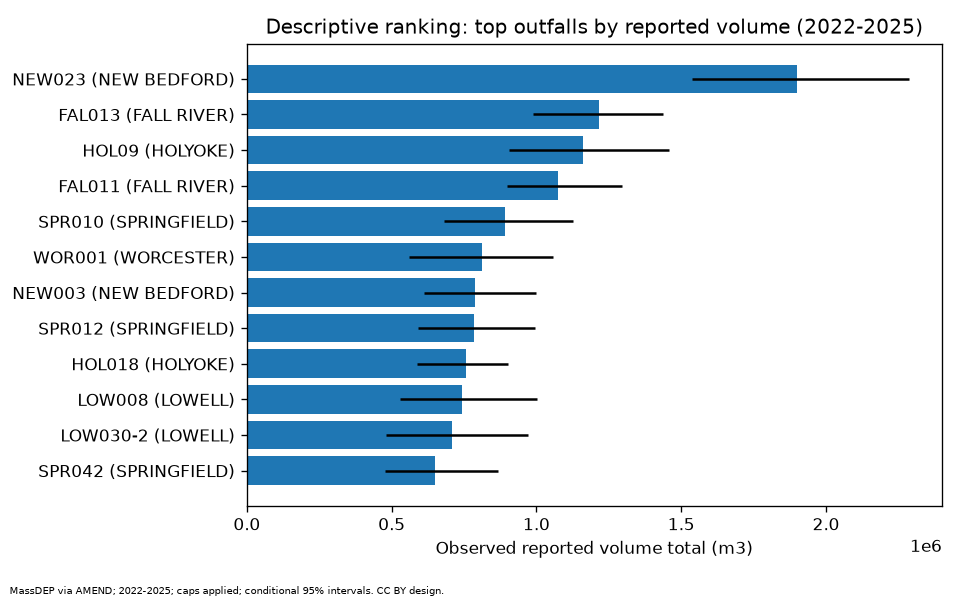

# Results

## Case study summary

Massachusetts EEA CSO notifications (2022 to 2025 hold-out on 2025) show stable
report-row counts across identifiers (Spearman 0.8510) but the simple mean-volume baseline beats the log1p rainfall model on pooled RMSE (4801.3 vs 12210.4 m3).
Descriptive volume totals exclude notifications above a 10 million gallon plausibility cap; cohort_summary.json reports a 32.1% volume reduction from that filter.

## Headline metrics

Hold-out test year 2025. Spearman n counts identifiers, including UNKNOWN permittee buckets.
RMSE n counts model-scorable paired report rows; multiple reports may describe one discharge.
Rainfall threshold is positive at or above the eligible training+validation 75th percentile (at least three rainfall observations per identifier). Of 1643 eligible known-rainfall test report rows, 1635 have threshold support; 8 rows across 5 identifiers default negative because support is insufficient. These rows remain in the denominator; missing rainfall is excluded. This event-conditional fraction does not measure overflow detection or accuracy on non-event days.
Intervals are conditional event-bootstrap ranges, not storm-blocked inference.

- **spearman_trainval_vs_test_frequency**: 0.8510 (95% CI [0.8302, 0.8543], n=171)
- **rmse_rainfall_model_m3**: 12210.4286 (95% CI [7100.5400, 16489.1477], n=1625)
- **rmse_mean_volume_baseline_m3**: 4801.3013 (95% CI [4454.0005, 5197.9809], n=1625)
- **rain_threshold_positive_rate**: 0.2404 (95% CI [0.2200, 0.2608], n=1643)

## Cohort flow

| Stage | Report rows |
|---|---:|
| CSO feed (all classes) | 16720 |
| Eligible across full feed | 16544 |
| Eligible 2022-2025 | 15122 |
| Eligible 2025 | 3075 |
| Eligible paired 2025 | 1643 |
| Model-scorable paired 2025 (same rows for baseline) | 1625 |

| Reporting class (full feed) | Rows | Missing volume or rain |
|---|---:|---:|
| Public Notification Report | 8059 | 8058 |
| Verified Data Report | 8661 | 0 |

Reporting stages are retained separately; the estimand is report rows, not distinct discharges.
Volume-cap exclusions: 156 evaluation-period reports; 159 across the full feed.
The volume-cap sensitivity uses 2022-2025 volume after other eligibility filters,
relative to the same cohort with the volume cap relaxed. The cohort ledger records
unknown identifier buckets and model-support exclusions by identifier.

## Volume-cap sensitivity

| Observed volume rank | With cap | Without volume cap |
|---|---|---|
| 1 | NEW023 | MWR203 |
| 2 | FAL013 | NEW023 |
| 3 | HOL09 | HOL09 |
| 4 | FAL011 | WOR001 |
| 5 | SPR010 | LOW008 |

Removing high-volume reports changes priorities; the uncapped leader can disappear
from the capped top five. These filters flag suspect values and do not verify errors.

## Reproduce

```bash
cso-insight run --root .
```

Hardware: Darwin arm

## Baselines

- event_count_ranking: rank by raw event count per outfall (no rainfall model) (cso-insight-baseline/1.0)
- mean_volume_per_event: predict arithmetic mean volume per outfall from train+validation (cso-insight-baseline/1.0)
- rainfall_threshold: positive when rainfall is at or above training+validation 75th percentile; fewer than 3 training rainfall observations default negative (cso-insight-baseline/1.0)

## Descriptive totals and uncertainty





MassDEP via AMEND, pinned snapshot; 2022-2025 eligible report rows. Points are observed totals; bars show conditional bootstrap intervals on metrics, not rank positions. Counts can include multiple reporting stages of one discharge. Volume caps can change priorities: inspect the capped/uncapped top-five comparison in the cohort ledger. Original figure design CC BY 4.0; upstream rights retained.
